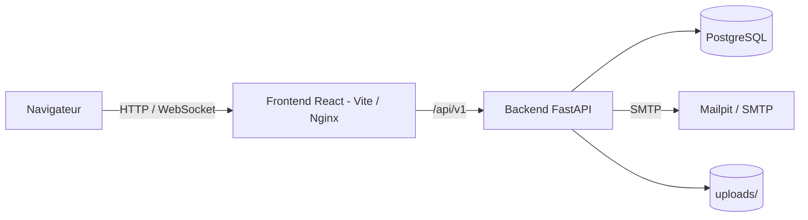

# Architecture

## Backend (`backend/app`)

| Dossier      | Rôle                                                        |
| ------------ | ----------------------------------------------------------- |
| `api/v1`     | Routeurs FastAPI (un fichier par domaine) et WebSocket      |
| `services`   | Logique métier, appelée par les routeurs                    |
| `models`     | Modèles SQLAlchemy                                          |
| `schemas`    | Schémas Pydantic (entrées / sorties)                        |
| `core`       | Configuration, sécurité (JWT), permissions, erreurs, logs   |
| `db`         | Base déclarative et session                                 |
| `emails`     | Gabarits d'emails                                           |
| `migration`  | Import depuis l'ancienne application et jeu de données de démonstration  |

Les migrations sont dans `backend/alembic`.

## Frontend (`frontend/src`)

| Dossier      | Rôle                                                   |
| ------------ | ------------------------------------------------------ |
| `features`   | Écrans par domaine (annuaire, agenda, messagerie, etc.) |
| `pages`      | Pages routées                                          |
| `auth`       | Contexte d'authentification, routes protégées, droits  |
| `components` | Composants de mise en page et UI partagés              |
| `realtime`   | Client WebSocket (chat, notifications)                 |
| `lib`        | Client API et utilitaires                              |

## Authentification et droits

JWT (accès + rafraîchissement). Rôles : `super_admin`, `staff` (droits fins), `member`, plus `is_company_admin` pour l'administrateur d'une entreprise.
