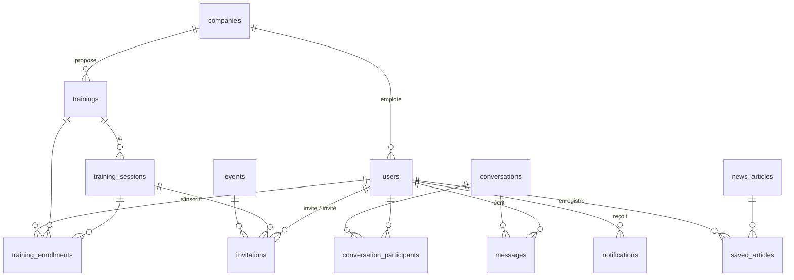

# Modèle de données

PostgreSQL, clés primaires UUID, dates en `timestamptz`. Migrations : Alembic (`backend/alembic`).
Suppression logique (`deleted_at`) sur utilisateurs, entreprises, formations, événements et messages.

## Choix

- Rôle utilisateur : `super_admin`, `staff` (droits fins dans `permissions`), `member` ; `is_company_admin` pour l'administrateur d'une entreprise.
- Une invitation cible soit un événement, soit une session (contrainte `exactly_one_target`).
- Unicité de l'email insensible à la casse (index sur `lower(email)`).
- Non-lu du chat : `conversation_participants.last_read_at` (pas de drapeau par message).
- Favoris d'actualités : copie de l'article, conservée après purge de l'original.
- Contenu éditable (page d'accueil) : table clé/valeur JSONB `site_contents`.
